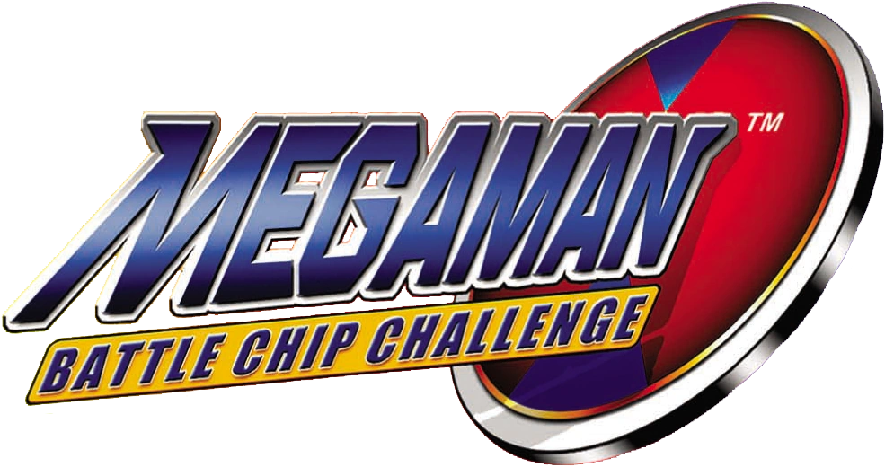

# MMBCCDecomp



A work-in-progress matching decompilation of **Mega Man Battle Chip Challenge (USA)** for the Game Boy Advance, in the pret style: C source that compiles with the era-appropriate toolchain to a **byte-identical** ROM.

This repository does **not** contain any game assets or a ROM. An existing copy of the game, legally obtained by you, is required to build.

## Progress

**C-matched: 1280 / 1677 functions (76.3%)**

```
███████████████░░░░░ 76.3% (1280/1677)
```

- 13 additional functions verified as assembly
- **1293 byte-identical functions total**
- Current build: 8,388,608 bytes, verified reproducible (SHA-1 `03970057b4a502a5ce77b804d9120bc7db034484` for the in-progress build)
- Next milestone: 80% (1342/1677)

Per-phase progress:

- Phase 0 Toolchain: ██████████ 100%
- Phase 1 Disassembly: ██████████ 100%
- Phase 2 Boundaries / naming: ██████████ 100%
- Phase 3 Matching C: ████████░░ 76.3% (1280/1677)
- Phase 4 Assets: ░░░░░░░░░░ 0% (text codec still unknown)
- Phase 5 Byte-identical build: ░░░░░░░░░░ 0% (pending `make compare`)

See [docs/STATUS.md](docs/STATUS.md) for the current status and [PROGRESS.md](PROGRESS.md) for the running log.

## Dependencies

- `make`, `git`, a host C compiler, `python3`
- `binutils-arm-none-eabi` 2.42 (ARM cross-binutils: assembler, linker, objcopy)
- `agbcc` — the era-appropriate GBA C compiler, commit `da598c1` from [pret/agbcc](https://github.com/pret/agbcc) (both `agbcc` and `old_agbcc` variants are used)
- `gbafix` / `gbagfx` — header and graphics tools (sources vendored under `mmbcc/tools/`; build them first, see below)

## Building

Clone the repository:

```sh
git clone https://github.com/Adeelshah001/MMBCCDecomp.git
cd MMBCCDecomp
```

Place your legally obtained dump of Mega Man Battle Chip Challenge (USA) as `mmbcc/baserom.gba`. It is never committed; `make check` verifies it is the expected dump by SHA-1 before anything else trusts it.

Build the helper tools from source (the top-level `make` does not build them for you):

```sh
make -C mmbcc/tools/gbafix
```

Build `agbcc` from [pret/agbcc](https://github.com/pret/agbcc) at commit `da598c1` and install the resulting tree (with `bin/`, `lib/` and `include/`) as `mmbcc/tools/agbcc/`.

Then build from the `mmbcc/` directory:

```sh
cd mmbcc
make check            # verifies your baserom by SHA-1
make                  # builds mmbcc.gba (8,388,608 bytes)
```

Verify the build against the original:

```sh
make compare
```

`make compare` gates on SHA-1 `72309736f3820470c6f372d6a05ad1f16bc5a946` (8,388,608 bytes, header title `BATTLECHIPGP`, game code `A89E`). The project is done when `make compare` passes. Until then, matched functions are verified individually: a function counts as matched only when its compiled bytes are byte-identical to the baserom, verified by build and diff (see `mmbcc/tools/regression_check.py`).

## Layout

- `ANALYSIS.md` — full ROM research and analysis findings (evidence first)
- `PLAN.md` — multiphase decompilation plan with entry/exit criteria
- `PROGRESS.md` — running progress log (functions matched / total, blockers)
- `mmbcc/` — the pret-style project: `Makefile`, `ldscript.ld`, `src/` (matched C), `asm/` (verified assembly), `tools/` (build scripts)
- `docs/` — research notes, function lists, cross-references, per-wave match notes, `match_status.tsv` (the match registry)
- `rom.sha1` — SHA-1 of the expected baserom (a hash record only, not the ROM)

## Legal note (absolute)

- **No ROM in this repository.** The baserom is supplied by the builder at build time and verified by SHA-1. This repository contains no game ROM, no BIOS, and no copyrighted assets (graphics, audio, text content).
- The baserom used for verification is a legally obtained dump: SHA-1 `72309736f3820470c6f372d6a05ad1f16bc5a946` (8,388,608 bytes, header title `BATTLECHIPGP`, game code `A89E`).
- Never download ROMs or distribute copyrighted assets. Analysis reads the builder's file in place; the tree builds from a user-supplied baserom only.
- Quirk reproduced by the build: the original cartridge's header checksum byte at `0xBD` is `0x7B` (computed `0x94`) — a factory mismatch, shipped on the cartridge, reproduced as-is.

## Credits

Built in the pret style, using `agbcc` and tooling in the lineage of the pret projects (see [decomps.net/tools](https://decomps.net/tools)).
